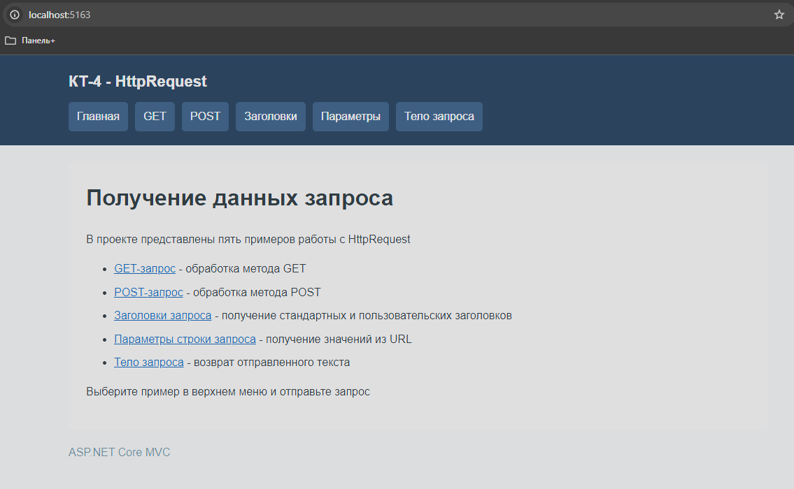
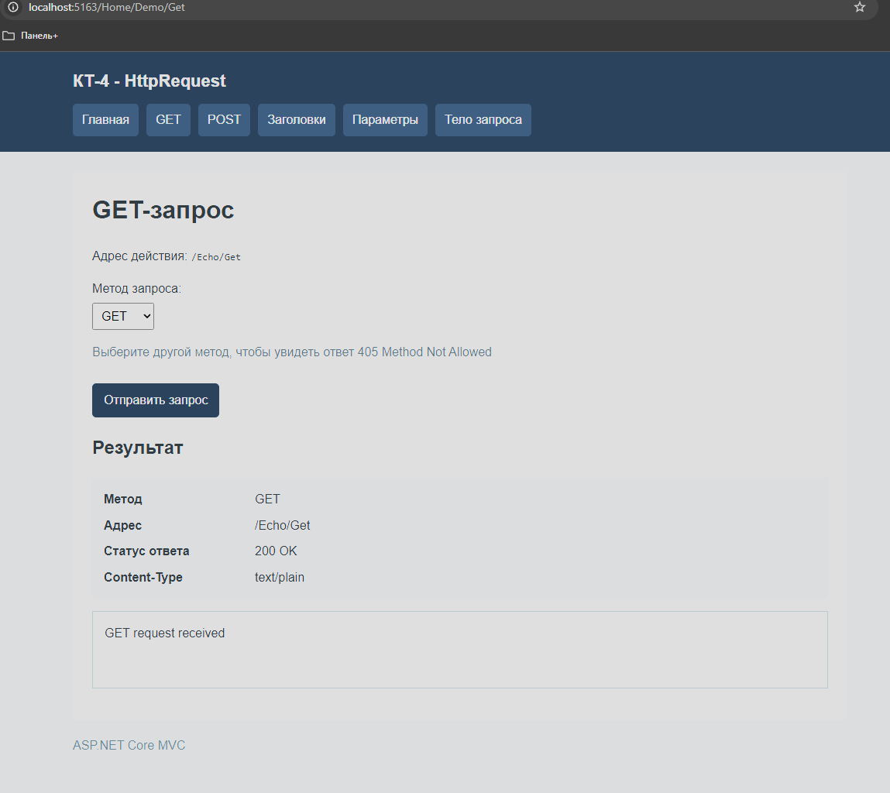
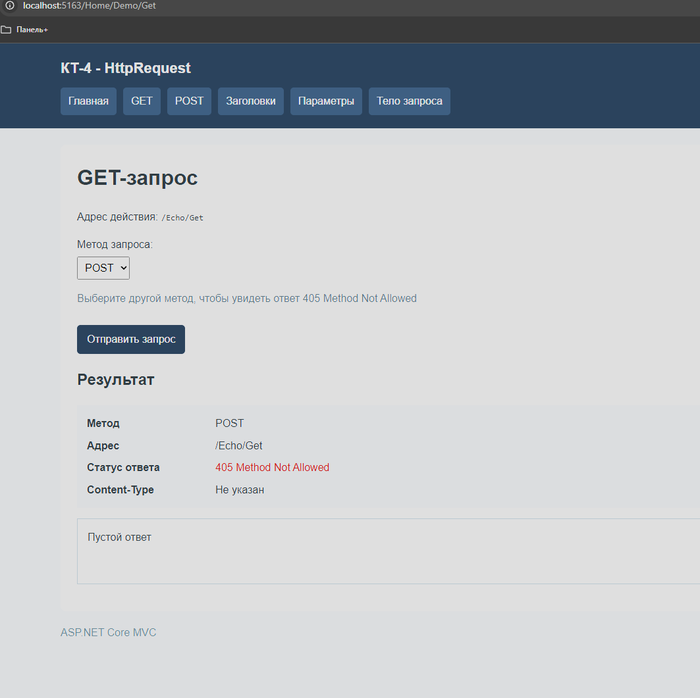
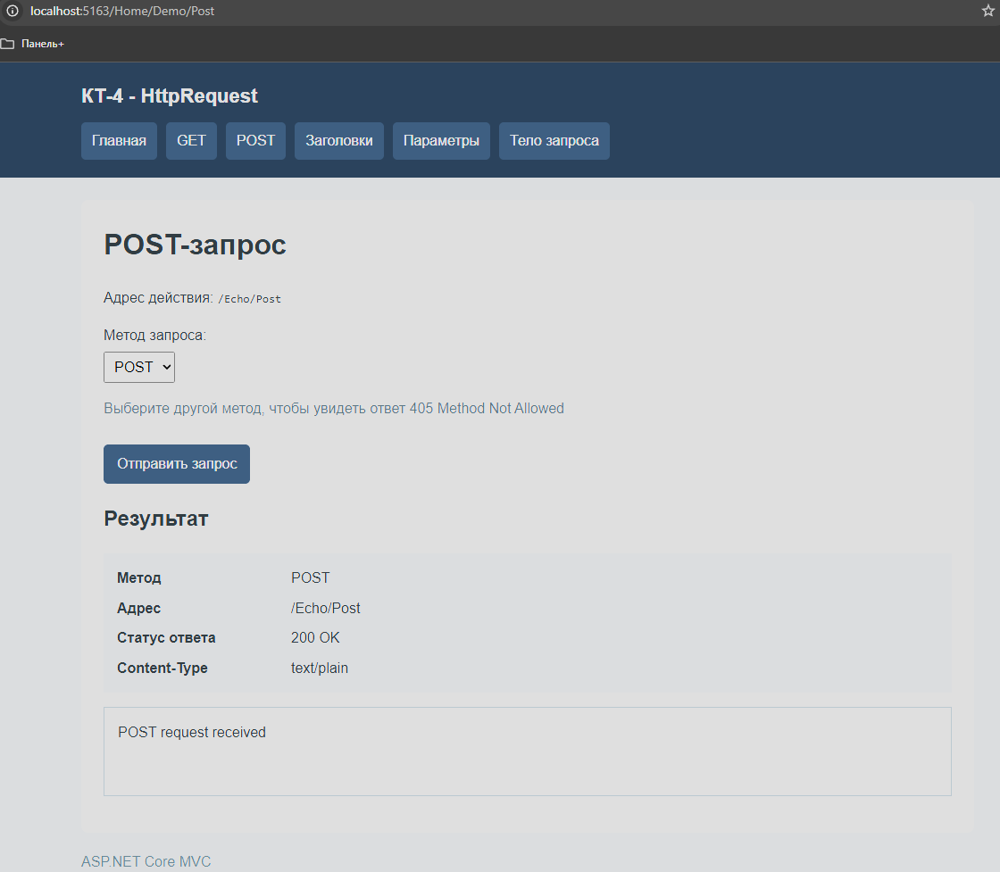
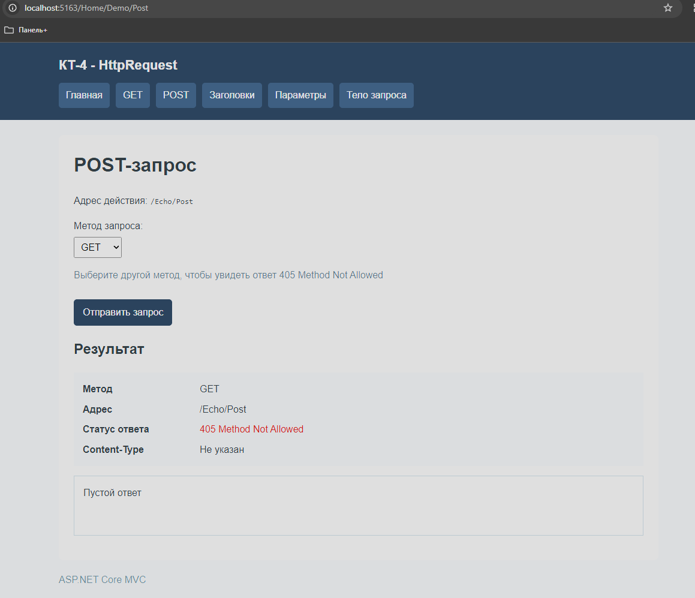
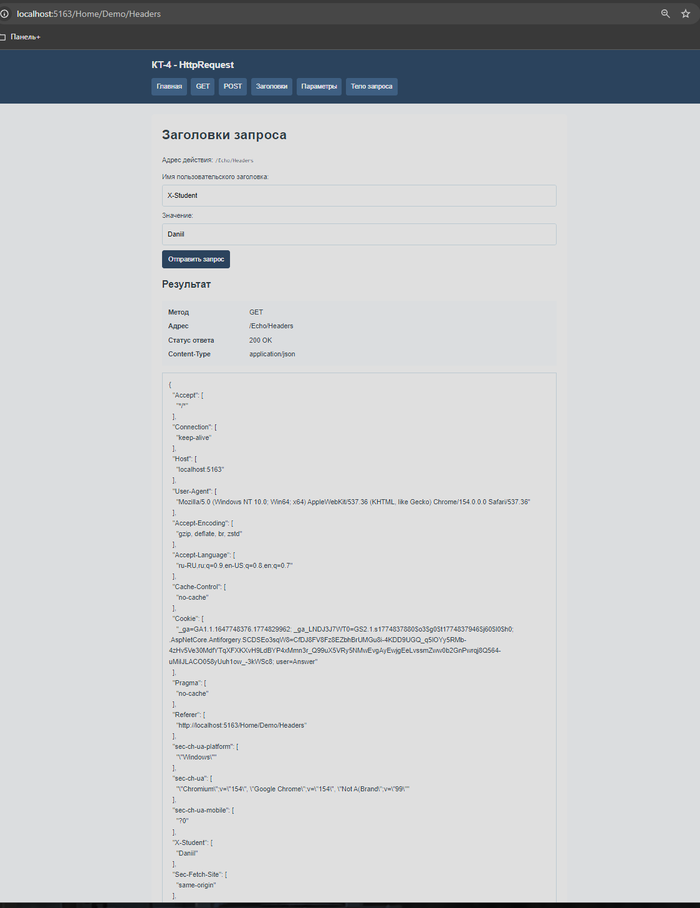
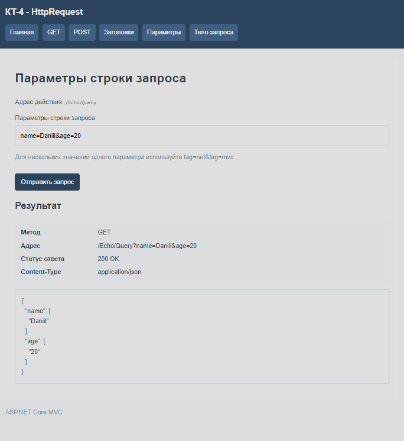
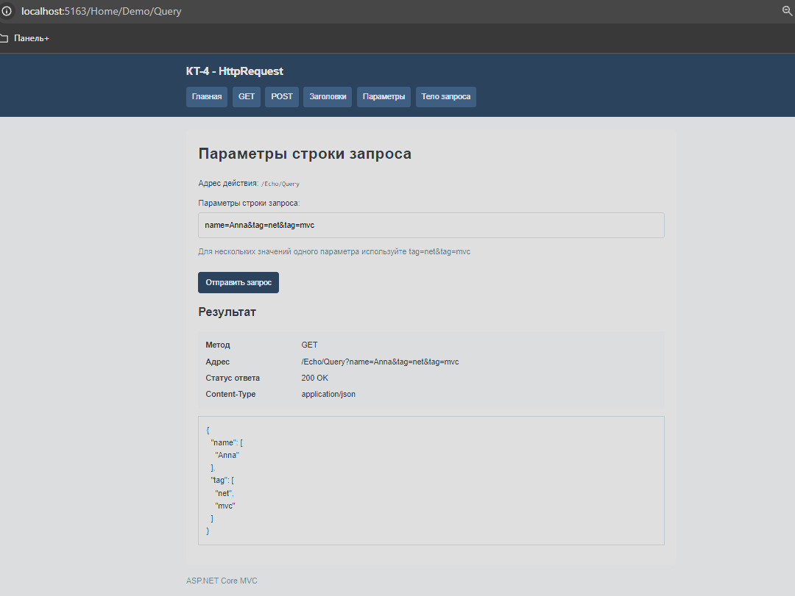
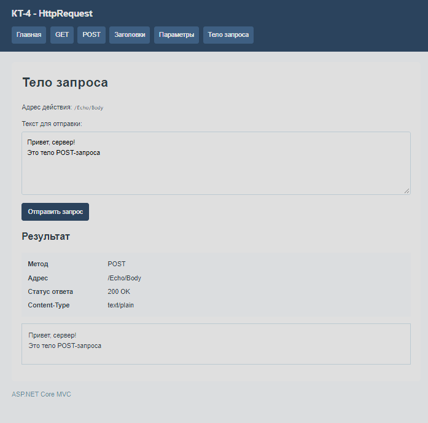
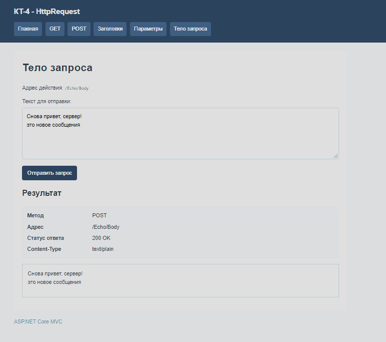

# КТ-4 - Получение данных запроса HttpRequest

Студент - Денисенко Даниил Евгеньевич  
Группа - 4п4.23 NET  
Дисциплина - ADO.NET  

### Задачи:

Создайте новый проект ASP.NET Core MVC с помощью Visual Studio или командной строки dotnet.

Добавьте новый контроллер с именем EchoController в папку Controllers. Унаследуйте его от класса Controller и убедитесь, что он имеет суффикс Controller в имени.

Добавьте действие с именем Get в контроллер, которое возвращает строку “GET request received” в виде текстового ответа. Используйте атрибут [HttpGet] для указания, что действие обрабатывает только GET-запросы. Используйте метод WriteAsync для отправки строки и установите свойство ContentType в “text/plain”.

Добавьте действие с именем Post в контроллер, которое возвращает строку “POST request received” в виде текстового ответа. Используйте атрибут [HttpPost] для указания, что действие обрабатывает только POST-запросы. Используйте метод WriteAsync для отправки строки и установите свойство ContentType в “text/plain”.

Добавьте действие с именем Headers в контроллер, которое возвращает все заголовки запроса в виде JSON-ответа. Используйте свойство Headers для получения заголовков и метод WriteAsJsonAsync для отправки их в виде объекта. Установите свойство ContentType в “application/json”.

Добавьте действие с именем Query в контроллер, которое возвращает все параметры из строки запроса в виде JSON-ответа. Используйте свойство Query для получения параметров и метод WriteAsJsonAsync для отправки их в виде объекта. Установите свойство ContentType в “application/json”.

Добавьте действие с именем Body в контроллер, которое возвращает тело запроса в виде текстового ответа. Используйте метод ReadAsStringAsync для чтения тела запроса и метод WriteAsync для отправки его в виде строки. Установите свойство ContentType в “text/plain”.

Запустите проект и проверьте, что вы можете отправить разные типы запросов к каждому действию по соответствующему URL, например, /Echo/Get, /Echo/Post, /Echo/Headers и т.д. Обратите внимание, как HttpRequest позволяет вам получить доступ к различным аспектам запроса.

### Задание 1

На главной странице перечислены пять примеров работы с HttpRequest
Общее меню позволяет перейти к GET, POST, заголовкам, параметрам строки запроса и телу запроса
Оформление выполнено в том же стиле, что и в предыдущих контрольных точках

Создан проект ASP.NET Core MVC
Контроллер EchoController находится в папке Controllers и наследуется от класса Controller
Для демонстрации используются страницы с общим макетом Views/Shared/_Layout.cshtml

На странице /Home/Demo/Get выбран метод GET и отправлен запрос к /Echo/Get
Отображаются строка GET request received, статус 200 OK и Content-Type text/plain

Действие Get помечено атрибутом [HttpGet]
Для отправки текста используется Response.WriteAsync

На той же странице выбран метод POST и отправлен новый запрос к /Echo/Get
Сервер возвращает статус 405 Method Not Allowed, поскольку действие Get обрабатывает только GET-запросы

### Задание 2

На странице /Home/Demo/Post выбран метод POST и отправлен запрос к /Echo/Post
Отображаются строка POST request received, статус 200 OK и Content-Type text/plain

Действие Post помечено атрибутом [HttpPost]
Для отправки строки используется Response.WriteAsync

На странице выбран метод GET и отправлен запрос к /Echo/Post
Сервер возвращает статус 405 Method Not Allowed, поскольку действие Post обрабатывает только POST-запросы

### Задание 3

На странице /Home/Demo/Headers указан пользовательский заголовок X-Student со значением Daniil
После отправки запроса отображается JSON со всеми полученными сервером заголовками, включая добавленный заголовок
Ответ имеет статус 200 OK и Content-Type application/json

Действие Headers получает заголовки через Request.Headers и преобразует их в словарь
Значения сохраняются в массивах, чтобы не потерять несколько значений одного заголовка
Для отправки JSON используется Response.WriteAsJsonAsync

### Задание 4

На странице /Home/Demo/Query отправлена строка name=Daniil&age=20
В JSON-ответе отображаются параметры name и age с переданными значениями
Ответ имеет статус 200 OK и Content-Type application/json

Действие Query получает параметры через Request.Query и отправляет их методом Response.WriteAsJsonAsync

В поле параметров введена строка name=Anna&tag=net&tag=mvc и отправлен новый запрос
В ответе параметр name содержит значение Anna, а параметр tag содержит оба значения net и mvc
Значения параметров сохраняются в массивах

### Задание 5

На странице /Home/Demo/Body отправлен многострочный текст
В результате отображается тот же текст с сохранением переводов строк
Ответ имеет статус 200 OK и Content-Type text/plain

Действие Body получает поток Request.Body
Поток передаётся в StreamContent, у которого вызывается метод ReadAsStringAsync
Полученная строка отправляется обратно методом Response.WriteAsync

Текст в поле изменён на новое многострочное сообщение и отправлен повторно
В результате отображается обновлённое тело запроса
Результат обновляется без перезагрузки всей страницы
